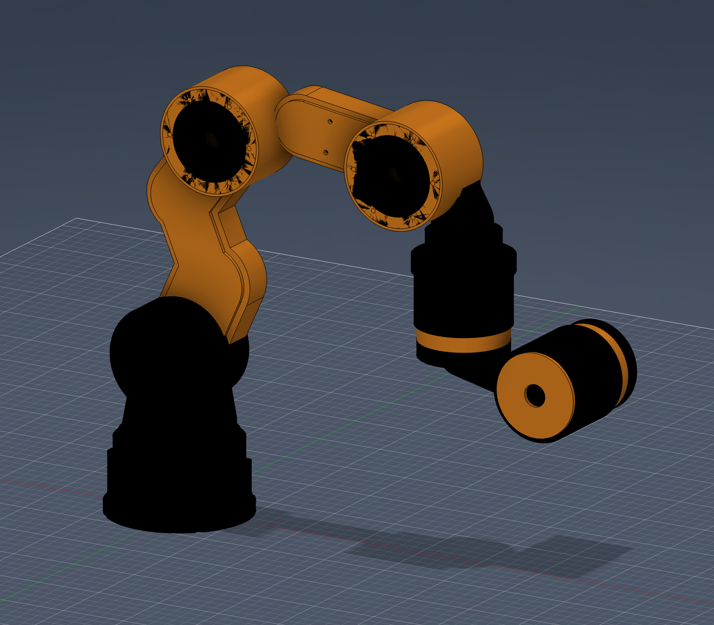
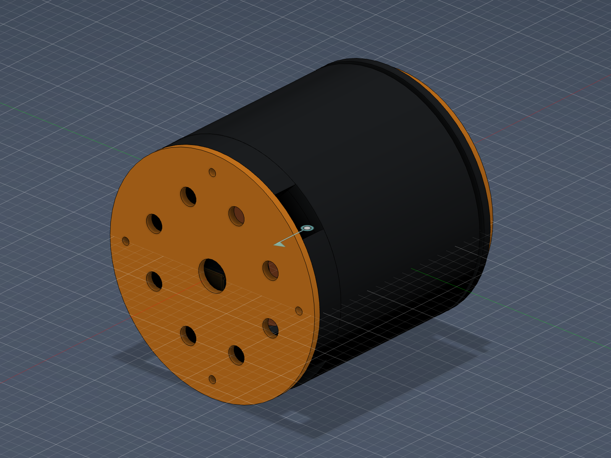

# 5008 六自由度机械臂与 Flex-Belt 关节原型

这套文件包含一版 5008 无刷电机六自由度机械臂外形/装配样机，以及一套参考 Flex-Belt 30:1 结构设计、带磁编码器 PCB 安装位的 5008 关节接口样件。

机械臂保留了原型的 S 形弯臂、嵌入式盖板和下弯前臂轮廓，并在原有 J1-J4 基础上增加 J5 腕偏航和 J6 工具滚转。当前目标是先打印、组装、观察比例和验证安装空间，不是直接制造可承载运行的成品机械臂。



## 目录

```text
5008-6dof-arm/
├── arm/
│   ├── source/     # Fusion 360 F3D 与通用 STEP 装配模型
│   ├── stl/        # 25 个机械臂打印件
│   └── preview/    # 装配预览
└── joint/
    ├── source/     # 已移除用户 PCB 和第三方参考网格的公共版 F3D 与 STEP
    ├── stl/        # 18 个关节壳体、接口和包络打印件
    ├── preview/    # 外观、内部、PCB 固定和接口开口预览
    └── PRINTING.md # 关节打印和试装说明
```

## 当前状态

| 项目 | 状态 |
| --- | --- |
| 机械臂自由度 | Fusion 装配中定义 6 个旋转关节 |
| 机械臂 STL | 25 个，二进制长度和封闭边检查通过，`bad_edges=0` |
| 新增 J5/J6 腕部 | 与原前臂的 Fusion 干涉检查为 0 |
| 关节 STL | 18 个，二进制长度和封闭边检查通过，`bad_edges=0` |
| 关节装配 | Fusion 干涉检查为 0 |
| 编码器 PCB 固定 | `4x M2` 十字孔位，左右 19 mm、上下 25 mm；需实物复核 |
| 动力与寿命 | 未验证 |
| 工作齿形 | 未包含，详见“第三方参考文件” |

## 5008 电机接口

当前设计采用以下电机包络和安装基准：

- 电机外径：58.5 mm
- 电机轴向包络：38 mm
- 电机轴：4 mm 参考值
- 正面安装孔：`4x M3`
- 安装孔中心半径：`R12 mm`，即 PCD24
- 推荐安装螺钉：`M3x6`
- 模型通孔直径：3.4 mm

`M3x6` 是螺钉规格，不是 6 个安装孔。装配前必须检查实际电机螺纹深度，避免螺钉顶到定子线圈。

## 机械臂文件

源模型：

- `arm/source/openrobot_5008_6dof_arm_r5.f3d`
- `arm/source/openrobot_5008_6dof_arm_r5.step`

STL 编号 `01-17` 是底座、S 形主体、盖板和 J2-J4 电机安装件；`18-25` 是新增的 J5/J6 腕部、输出盘和夹爪法兰。每个 STL 打印 1 件。

末端接口：

- J5 转接盘连接原前臂：`4x M5 / PCD44`
- J5/J6 输出接口：`6x M4 / PCD52`
- 夹爪预留接口：`4x M4 / PCD40`
- 工具过线孔：直径 20 mm

最大主体零件约为 `115x66x245 mm`。250/256 mm 级打印平台可以尝试打印；220 mm 平台需要先对长件进行可靠分段，不能直接缩放，否则电机和螺孔尺寸会一起改变。

## Flex-Belt 编码器关节文件



源模型：

- `joint/source/openrobot_flexbelt_30to1_5008_encoder_joint_r8.f3d`
- `joint/source/openrobot_flexbelt_30to1_5008_encoder_joint_r8.step`

接口和包络：

- 关节总体包络：约 `OD104 x 106 mm`，包含可拆后盖
- 机械臂机架接口：`8x M4 / PCD84`
- 输出接口：`6x M4 / PCD70`
- 5008 安装：`4x M3x6 / R12`
- PCB 外形参考：直径 34 mm、厚 1.606 mm
- PCB 固定：`4x M2`，通孔直径 2.2 mm
- PCB 十字孔距：左右 19 mm、上下 25 mm
- 打印柱底孔：直径 1.6 mm，建议先试 `M2x6` 尼龙自攻螺钉
- 后部维修盖：`4x M3 / PCD88`
- 参考齿数：90T 转子和 93T 定子
- 理论减速比：`90 / (93 - 90) = 30:1`

R8 根据用户提供的 PCB STEP 保留了电子元件参考，并用正确的四孔圆板替换了 STEP 中误导出的无孔实心板。公共版不包含用户原始 PCB 实体，只保留板框、编码器和主要连接器的装配包络。

`joint/stl/` 中名称含 `Envelope` 的零件是空间包络或接口验证件，不是带工作齿形的最终传动件。它们可以打印检查装配空间，但不能替代 90T/93T 工作齿圈。首次打印前请先读 `joint/PRINTING.md`。

## 磁编码器与 PCB

- 编码器芯片位于 PCB 中心、电机侧。
- 参考磁环包络为 `OD10 / ID4.2 x 3 mm`，仍需用实际磁环复核。
- 模型中的名义磁间隙为 0.58 mm，仅用于布置，不能直接作为最终装配值。
- MR30、2P 与双 10P 接口对应位置均留有径向开口，装配时仍应检查插头外壳和线缆弯曲半径。
- M2 只固定 PCB；5008 电机正面的四颗固定螺钉仍为 M3x6。

## 轴承建议

以下型号是下一轮承载结构的采购候选，不是当前 R5/R6 已完成的标准轴承座：

| 位置 | 候选轴承 | 尺寸 | 预计配置 | 建议 |
| --- | --- | --- | --- | --- |
| J1-J4 主关节 | `6906-2RS` | `30x47x9 mm` | 每轴 2 只 | 先买 2 只测量 |
| J5-J6 腕关节 | `6804-2RS` | `20x32x7 mm` | 每轴 2 只 | 先买 2 只测量 |

收到轴承后应使用卡尺测量外径、内径和厚度，再按打印材料、机器误差和装配方式确定座孔公差。20/30 mm 内圈也需要独立输出轮毂，不能直接套在 4 mm 电机轴上。

## 柔性齿圈与同步带实验

如需购买商用同步带做尺寸实验，可搜索：

- `180-2GT-6` 闭环同步带
- 齿数：90
- 节距：2 mm
- 节线长度：180 mm
- 节圆直径：约 57.30 mm
- 带宽：6 mm

普通闭环同步带通常带有玻璃纤维或钢丝线芯，可能无法像柔轮一样稳定椭圆变形。该规格只用于尺寸实验，不代表已经确认能用作 Flex-Belt 柔性齿圈。

拿到实物后至少记录实际外径、实际内径、总厚度、齿高和实际宽度，再重画转子和预紧结构。

## 打印建议

- 外形和首次试装：PETG 或 PLA+
- 层高：0.20 mm
- 壁数：主体 4-5 圈，电机板/输出盘/腕部载体至少 5 圈
- 顶底层：至少 5 层
- 填充：主体 30%-40% Gyroid，承力接口 40%-60%
- 孔加工：打印后用钻头轻修；标注为 M4 底孔的位置需攻丝
- 长件应根据层纹受力方向摆放，不要仅为了减少支撑而让关节连接处沿易分层方向打印

第一次装配只进行手转和低速空载检查。建议依次检查：

1. 零件是否翘曲，安装面是否贴合。
2. 电机螺钉长度是否安全。
3. 所有关节是否有机械卡点和线缆拉扯。
4. 输出端是否存在明显径向间隙或轴向窜动。
5. 低速运行时的温升、噪声和电流是否异常。

## 动力与力矩反馈

5008 直驱不足以让这套机械臂稳定保持姿态，尤其是肩和肘。初始减速比建议范围：

- J1-J3：约 30:1
- J4-J5：约 15-30:1
- J6：约 10-20:1

第一版可以使用 FOC 控制器的 q 轴电流做力矩估算，但这不是精确的末端外力传感。后续若需要可靠的碰撞检测和力矩反馈，应增加输出端弹性元件与应变片，或使用独立扭矩/六维力传感器，并完成标定。

## 第三方参考文件

关节设计阶段使用过用户提供的 Flex-Belt 90T/93T STL 作为尺寸参考，但该目录没有作者信息、来源链接或许可证。为避免把来源不明的第三方模型直接公开：

- 本仓库没有提交那 4 个原始带齿 STL。
- 公开版关节 F3D 已删除全部第三方参考网格。
- STEP 与 `joint/stl/` 只包含本项目生成的壳体、接口件和包络体。

在补齐可再分发的来源和许可证之前，不应把第三方齿形文件加入仓库。后续可以重新建立原创参数化 GT2 90T/93T 齿形，或采用许可证兼容的公开设计。

## 安全与限制

当前版本可以用于 3D 打印、外形检查、孔位检查和手动活动验证，但尚未完成：

- 工作齿形与齿隙公差
- 轴承座、预紧和输出轮毂
- 关节额定扭矩与刚度
- 疲劳寿命与跌落/冲击测试
- 润滑、温升和连续运行测试
- 线缆管理、机械限位和急停链路
- 夹爪承载和整机碰撞包络验证

在上述项目完成前，不要让机械臂带负载高速运行，也不要在人或易损物体附近测试。

## 版本

- 机械臂：R5
- Flex-Belt 编码器接口关节：R8 public
- 发布日期：2026-10-26
